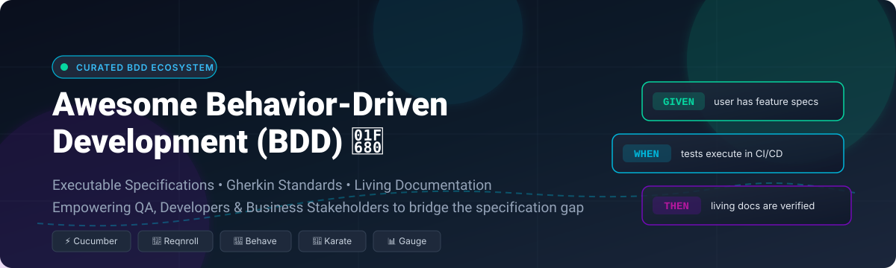

  

# 🚀 Awesome-Behavior-Driven-Development-BDD

  
  
  
  
  
  
  

---

## 📖 Top Behavior-Driven Development (BDD) Ecosystem

**Curated Directory of SaaS Platforms & Open-Source GitHub Repositories for Behavior-Driven Development**  
*Comprehensive resource for Gherkin specifications, acceptance test automation, step definitions, living documentation, and agile test-driven collaboration.*

**Last updated:** October 2026

This repository tracks notable **SaaS platforms** and **open-source frameworks** designed for **Behavior-Driven Development (BDD)**, **Acceptance Test-Driven Development (ATDD)**, and **Specification by Example (SBE)**. These tools enable software teams to write human-readable, executable specifications in natural language, bridging communication gaps across business analysts, product owners, QA automation engineers, and software developers.

---

## 📑 Table of Contents

- [📈 Sector Overview & Market Dynamics](#-sector-overview--market-dynamics)
- [☁️ SaaS / Hosted Platforms](#️-saas--hosted-platforms)
- [💻 Open-Source GitHub Projects](#-open-source-github-projects)
- [🛠️ Framework Architecture Guide](#️-framework-architecture-guide)
- [🤝 How to Contribute](#-how-to-contribute)
- [💖 Support](#-support)
- [⭐ Star History](#-star-history)
- [⚖️ Disclaimer](#️-disclaimer)

---

## 📈 Sector Overview & Market Dynamics

The global continuous testing and automated software quality market is estimated at approximately **$28 billion to $35 billion**, expanding at a robust compound annual growth rate (CAGR) of over **15% to 18%** as AI-driven quality assurance and CI/CD automation adoption surge.

Market dynamics demonstrate a **moderately fragmented landscape**: while enterprise heavyweight consolidators like OpenText (UFT One), Tricentis (Tosca, qTest), and SmartBear hold concentrated market share in regulated enterprise tiers, vibrant open-source ecosystems (such as Cucumber, Ginkgo, Karate, and Reqnroll) and next-gen AI automation challengers prevent a winner-take-all outcome, maintaining healthy community diversity and vendor independence across languages.

---

## ☁️ SaaS / Hosted Platforms

| Platform | Company / Owner | Company Size (Revenue / Valuation) | Pricing (Starting Tier) | Free Tier Limits / Trial Limits | Description |
|---|---|---|---|---|---|
| **[Micro Focus UFT (OpenText)](https://www.microfocus.com/)** | OpenText | $5.25B revenue (FY24, Public: OTEX) | Starts at ~$3,200/seat/year (~$267/month) | No free tier; 30-day proof-of-concept (PoC) evaluation license available upon request | Enterprise standard for functional test automation and Gherkin BDD in enterprise & regulated environments. |
| **[Tricentis Tosca](https://www.tricentis.com/)** | Tricentis | $4.5B valuation | Starts at ~$20,000/year (~$1,667/month base deployment) | No permanent free tier; 14-day free trial with access to core test automation & model-based modules | Enterprise continuous testing platform offering model-based automation and BDD support. |
| **[QASymphony (Tricentis qTest)](https://www.tricentis.com/products/qtest/)** | Tricentis | $4.5B valuation | Starts at ~$50–$90/user/month (or ~$1,000/user/year) | No permanent free tier; 14-day free trial across qTest Manager, Sessions, Explorer, and Pulse modules | Test management platform with BDD support via qTest Scenario, requirements traceability, and Jira integration. |
| **[Gauge Cloud](https://gauge.org/)** | ThoughtWorks | $1.13B revenue (Apax Partners) | Free (Core engine is 100% open-source Apache 2.0; cloud runner costs depend on cloud infra) | Free forever (100% open-source tool; unmetered local test authoring and execution; infrastructure usage billed by cloud provider) | Markdown-based test specification and living documentation framework developed by ThoughtWorks. |
| **[CucumberStudio](https://cucumber.io/)** | SmartBear | ~$500M+ revenue | Starts at $32/user/month (Starter cloud tier) | No permanent free tier for studio; 14-day free trial with full feature collaboration and test management access | Collaborative BDD platform providing feature file editing, test execution tracking, and living documentation hosting. |
| **[Katalon Studio](https://katalon.com/)** | Katalon | ~$40M–$60M ARR | Starts at $84/user/month (Professional plan, billed annually) | Free forever plan: restricted to local test authoring/manual execution, no CLI/CI-CD pipeline execution without paid KRE add-on | Comprehensive test automation platform with native BDD feature files and Groovy step definitions. |
| **[Testsigma](https://testsigma.com/)** | Testsigma | ~$5M–$10M ARR ($18M funding) | Starts at $8/user/month (Test Management Pro) / $14/user/month (AI Suite) | Free forever plan for test management (basic tier); 14-day free trial for Cloud Test Automation platform | AI-driven continuous test automation platform featuring codeless NLP test authoring and BDD execution. |

---

## 💻 Open-Source GitHub Projects

Curated list of production-ready, open-source BDD libraries and execution runners, sorted in descending order by GitHub stargazers count:

- **[Ginkgo](https://github.com/onsi/ginkgo)**   
  **Expressive BDD testing framework for Go** (MIT) . **Features**: Rich DSL with `Describe`, `Context`, `It`, `BeforeEach`, `JustBeforeEach`, expressive matcher library (Gomega), focused specs, table-driven test specs, and out-of-the-box parallel test execution across CPU cores . **The de facto BDD standard in the Kubernetes and cloud-native Go ecosystem** .

- **[Karate](https://github.com/karatelabs/karate)**   
  **Unified test automation framework with BDD syntax for API, UI, and performance testing** (Apache-2.0) . **Features**: Plain-text Gherkin-like syntax without needing separate step definitions, built-in JSON/XML payload validation, HTTP mock server integration, Gatling performance integration, and rich HTML reporting . **The fastest path to BDD for API automation** .

- **[Cucumber.js](https://github.com/cucumber/cucumber-js)**   
  **Official JavaScript and TypeScript implementation of Cucumber** (MIT) . **Features**: Full Gherkin language parser (`Feature`, `Scenario`, `Given`, `When`, `Then`, `Examples`), step definitions with regex/expression matching, async hooks, tags, data tables, custom world contexts, and parallel worker execution . **Integrates seamlessly with Playwright, Puppeteer, Jest, Vitest, and WebdriverIO** .

- **[Cucumber-Ruby](https://github.com/cucumber/cucumber-ruby)**   
  **The original reference implementation of Cucumber in Ruby** (MIT) . **Features**: Clean Gherkin syntax parsing, Capybara browser testing integration, extensive ecosystem of Ruby gems, scenario outlines, and expressive step definitions . **The historic pioneer of Behavior-Driven Development** .

- **[Behat](https://github.com/Behat/Behat)**   
  **The standard BDD framework for PHP applications** (MIT) . **Features**: Gherkin feature files, step definitions in PHP, hook life-cycles, tag filtering, Mink browser abstraction layer integration, and modular extension architecture . **Widely utilized across Symfony, Laravel, and Drupal enterprise teams** .

- **[Spock](https://github.com/spockframework/spock)**   
  **Expressive testing and specification framework for Java and Groovy applications** (Apache-2.0) . **Features**: Clear BDD-style blocks (`given:`, `when:`, `then:`, `expect:`, `where:`), powerful built-in mocking and stubbing, parameterized data-driven testing tables, and deep JUnit runner compatibility .

- **[Behave](https://github.com/behave/behave)**   
  **Primary Gherkin BDD framework for Python** (BSD-2-Clause) . **Features**: Native Gherkin feature files, Python step implementations, `environment.py` life-cycle hooks (`before_all`, `after_all`, `before_scenario`), tag filtering, scenario outlines, and JUnit/JSON test reporters .

- **[Cucumber-JVM](https://github.com/cucumber/cucumber-jvm)**   
  **Official Cucumber implementation for Java, Kotlin, and the JVM** (MIT) . **Features**: Gherkin feature files, step definitions across JVM languages, dependency injection modules (Spring, Guice, CDI, PicoContainer), JUnit 5 / TestNG engines, and parallel scenario execution .

- **[Gauge](https://github.com/getgauge/gauge)**   
  **Lightweight cross-platform specification runner created by ThoughtWorks** (Apache-2.0) . **Features**: Markdown-based executable specifications, multi-language runners (Java, JS/TS, Python, Ruby, C#, Go), data-driven tables, parallel execution, and living documentation generation .

- **[Godog](https://github.com/cucumber/godog)**   
  **Official Cucumber BDD framework for Go** (MIT) . **Features**: Native Gherkin file support, idiomatic Go test integration (`go test`), concurrent scenario execution, step argument transformation, and sub-test reporting .

- **[pytest-bdd](https://github.com/pytest-dev/pytest-bdd)**   
  **BDD specification plugin for pytest** (MIT) . **Features**: Seamless integration with pytest fixtures, parametrization, markers, and plugin ecosystem; avoids global state by leveraging pytest dependency injection .

- **[Reqnroll](https://github.com/reqnroll/Reqnroll)**   
  **The official open-source successor to SpecFlow for .NET and C#** (MIT) . **Features**: Full Gherkin feature files, step definitions in C#, dependency injection, hooks, parallel execution, and direct migration path from legacy SpecFlow projects .

- **[Serenity BDD (Core)](https://github.com/serenity-bdd/serenity-core)**   
  **Automated acceptance testing and rich living-documentation library** (Apache-2.0) . **Features**: Comprehensive illustrated test reports, Screenplay Pattern implementation, deep integration with Cucumber-JVM, JUnit, and Selenium/Playwright .

- **[Cucumber-Rust](https://github.com/cucumber-rs/cucumber)**   
  **Official Cucumber implementation for Rust** (MIT/Apache-2.0) . **Features**: Gherkin feature parsing, async step definitions powered by Tokio, attribute procedural macros, custom world states, and compile-time guarantees .

- **[Concordion](https://github.com/concordion/concordion)**   
  **Specification by Example engine for Java** (Apache-2.0) . **Features**: Markdown and HTML-based specifications with embedded instrumentation, automated test execution, and generation of verified specification documents .

- **[JBehave Core](https://github.com/jbehave/jbehave-core)**   
  **The pioneering Java BDD framework originated by Dan North** (BSD-3-Clause) . **Features**: Textual user stories, configurable step matchers, Spring and JUnit embedders, and tabular reporting .

---

## 🛠️ Framework Architecture Guide

Creating a scalable, cross-language Behavior-Driven Development architecture:

- ☕ **JVM (Java / Kotlin)**: Use **Cucumber-JVM** or **Spock** for web/unit flows; pair with **Serenity BDD** for living documentation.
- 🌐 **Web & Node.js (TypeScript / JavaScript)**: Use **Cucumber.js** combined with **Playwright** or **WebdriverIO** for fast end-to-end browser automation.
- 🔷 **.NET / C#**: Standardize on **Reqnroll** (the official, actively maintained successor to discontinued SpecFlow).
- 🐍 **Python**: Choose **pytest-bdd** for clean fixture reuse or **Behave** for classic Gherkin directory structures.
- 🐹 **Go**: Choose **Ginkgo** for developer-centric expressive specs or **Godog** for stakeholder-facing Gherkin syntax.
- 📡 **REST & GraphQL API Testing**: Use **Karate** for zero-step-definition declarative HTTP validation.

---

## 🤝 How to Contribute

Contributions are welcome and appreciated! Help keep this ecosystem up to date:

1. 🍴 Fork the repository.
2. 🌿 Create a feature branch: `git checkout -b feature/add-bdd-tool`.
3. 📝 Add your entry to `README.md` following the existing format:
   - Tool name, official website, and GitHub repository.
   - License and star badge (for open source).
   - Clear 1–2 sentence description of key capabilities.
4. 🚀 Submit a Pull Request with context on why the tool belongs on the list.

---

## 💖 Support

Thank you for exploring and supporting this curated BDD ecosystem! 🌟  
If this project helped you or your engineering team adopt behavior-driven development:

- ⭐ **Star this repository** to help others discover it!
- 🍴 **Fork and share** with colleagues and testing communities.
- ☕ **Support the maintainer**: Buy a coffee or become a sponsor on the [GitHub Sponsors Dashboard](https://github.com/sponsors/ishandutta2007)!

---

## ⭐ Star History

---

## ⚖️ Disclaimer

- This is a community-curated directory intended for research, evaluation, and educational purposes. Mention of specific vendors or open-source projects does not constitute formal endorsement.
- Ensure test specifications containing Gherkin scenarios adhere to organizational privacy policies (GDPR, CCPA, HIPAA) and do not store sensitive credentials or real customer PII in plain-text feature files.
- **SpecFlow is officially discontinued**: Existing .NET projects should migrate to [Reqnroll](https://github.com/reqnroll/Reqnroll), which retains backwards-compatible APIs and active community maintenance.
- **BDD is a communication practice first, tooling second**: Tools without active three-amigos collaboration (Product, QA, Dev) will simply automate brittle tests with unnecessary ceremony. Keep step vocabularies focused and concise!

---

  <b>Built with ❤️ for QA automation engineers, developers, and product teams practicing Behavior-Driven Development.</b>

